<div align="center">

  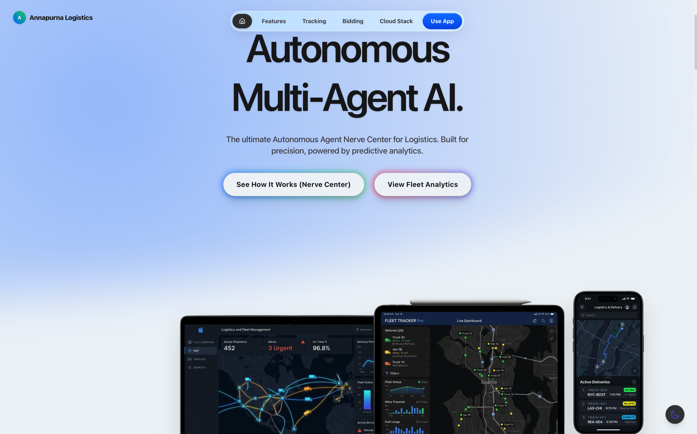
  
  <br/>
  <br/>
  
  <h1>🏔️ Annapurna Logistics</h1>
  
  <h3>Autonomous Multi-Agent AI · Emergency Cargo Rescue · Real-Time Cold-Chain Intelligence</h3>
  
  <p>
    <em>Minimizing waste. Maximizing efficiency. Saving the harvest.</em>
  </p>
  
  <p>
    <a href="https://github.com/Kenkei69/Annapurna"></a>
    <a href="https://github.com/Kenkei69/Annapurna"></a>
    <a href="https://github.com/Kenkei69/Annapurna/issues"></a>
  </p>

  <p>
    
    
    
    
    
  </p>

  <p>
    <a href="#-the-problem">The Problem</a> •
    <a href="#-the-solution">The Solution</a> •
    <a href="#-key-platform-features">Features</a> •
    <a href="#-ai-engine--autonomous-capabilities">AI Engine</a> •
    <a href="#-iot-hardware-prototype--firmware">IoT Hardware</a> •
    <a href="#-architecture">Architecture</a> •
    <a href="#-security--guardrails">Security</a> •
    <a href="#-getting-started">Getting Started</a> •
    <a href="#-attribution--origin">Attribution</a>
  </p>
</div>

---

## 💔 The Problem

Every year, over **₹1.5 Lakh Crore (US$18 Billion)** of perishable food is lost in transit due to broken cold chains and fragmented logistics. 

> **Over 40% of India's perishable food harvest is lost before reaching consumers.**

Conventional logistics systems rely on **reactive telematics** — notifying managers only after a compressor failure or temperature breach has already ruined the cargo. By the time a breakdown report is acknowledged, the cargo has spoiled, the farmer absorbs catastrophic losses, and wholesalers receive empty trucks.

---

## 💡 The Solution

**Annapurna** is an **autonomous, multi-agent AI logistics ecosystem** designed to stop food spoilage in transit before it occurs.

By combining real-time edge telemetry from custom IoT hardware with an autonomous multi-agent AI pipeline, Annapurna continuously monitors refrigerated fleets. The instant an anomaly or cooling compromise is identified, the system activates autonomously:

1. 🧠 **Analyzes** — Runs predictive spoilage models to determine the remaining safe time-to-spoil window.
2. 🔀 **Reroutes** — Calculates optimal emergency reroutes to the closest verified cold storage or wholesale hub within 50km.
3. 📢 **Broadcasts** — Launches a distress commodity auction alerting local certified wholesalers.
4. 💰 **Negotiates** — Multi-agent AI conducts real-time automated 3-round negotiations ensuring equitable prices.
5. ⚖️ **Validates** — An AI Legal Assistant checks regulatory compliance against food safety standards (such as FSSAI) in real time.
6. 📧 **Notifies** — Dispatches immediate multi-channel alerts (SMTP email and WhatsApp via Twilio) to drivers, dispatchers, and buyers.
7. 🌍 **Tracks ESG** — Computes real-time metrics on metric tons of food salvaged, revenue protected, and carbon emissions mitigated.

**Autonomous end-to-end response in under 90 seconds.**

---

## 🚀 Key Platform Features

### 🧠 Autonomous Agent Nerve Center
Watch multi-agent reasoning in real time. The **MonitorAgent**, **DecisionAgent**, and **NotificationAgent** communicate, make rerouting calculations, and execute state changes automatically via structured tool bindings.

### 📊 Fleet Command Center & Live GPS Telemetry
Track fleet assets with pinpoint GPS precision on interactive Leaflet maps. Live telemetry feeds display temperature, ambient humidity, ethylene gas concentrations, speed, and real-time ETAs.

### 🌡️ Cold-Chain Anomaly Intelligence
Real-time temperature spike detection paired with predictive forecasting models. When refrigeration integrity deteriorates, autonomous rerouting protocols trigger immediately to redirect cargo to the nearest qualified facility.

### 🏪 Emergency Wholesaler Marketplace & AI Negotiation
When cargo enters distress status, nearby wholesalers are alerted with real-time bidding interfaces. The platform includes an autonomous AI negotiation agent that counters lowball offers through multi-turn valuation reasoning.

### 🔍 Multi-Criteria Telemetry Filtering & Search
Filter distress cargo across 10+ operational criteria:
- Real-time telemetry thresholds (temperature, humidity, ethylene)
- Geospatial radius and proximity
- Price per kilogram and remaining shelf-life windows
- AI Smart Filter parsing natural-language prompts (e.g., *"seafood under 300 rupees within 40km"*)
- One-click CSV export and persistent filter layout templates

### 💬 Live Operations Chat & Embedded AI Assistant
Real-time messaging allows wholesalers to converse directly with fleet directors when human intervention is preferred. A persistent, context-aware AI Help Assistant is available across every screen.

### 📱 Multi-Channel Emergency Dispatch
Configurable automated emergency notifications through SMTP email (Nodemailer) and WhatsApp messaging (Twilio).

### ⚖️ Regulatory & Compliance Assistant
Retrieval-Augmented Generation (RAG) assistant grounded in perishable goods transport standards, delivering automated liability reports and temperature compliance verifications.

### 🌍 Vernacular Localization
Support for localized translations (Hindi, Marathi, Tamil, Telugu, and English) powered by the Google Cloud Translation API to assist diverse frontline operators.

---

## 🧠 AI Engine & Autonomous Capabilities

| # | Capability | Description |
|---|---|---|
| 1 | **Multi-Agent Orchestration** | Autonomous handoff between Monitor, Decision, and Notification agents with verifiable audit trails. |
| 2 | **Agent Development Kit (ADK)** | Function-calling tools enabling agents to autonomously execute rerouting commands and marketplace creation. |
| 3 | **Conversational Analytics** | Natural-language query interface translating plain-text questions into scoped SQL reports. |
| 4 | **Predictive Spoilage Forecasting** | Time-series forecasting predicting spoilage risk windows up to 14 days in advance. |
| 5 | **Vision AI Quality Control** | Multi-modal visual inspection of cargo at delivery checkpoints, grading freshness and spotting spoilage. |
| 6 | **Legal Compliance RAG** | Vector-embedded regulatory knowledge base verifying transport standards in real time. |
| 7 | **Voice Fleet Operations** | Voice command recognition allowing hands-free status checks and navigation. |
| 8 | **Document Processing** | Optical document extraction for transport manifests, receipts, and invoices. |

---

## 🔌 IoT Hardware Prototype & Firmware

Annapurna pairs with physical edge hardware built on the **ESP32-S3** microcontroller to capture and analyze environmental telematics at the cargo level.

```
[ DHT22 Sensor ]     ──( Temperature & Humidity )──┐
[ MQ-135 Sensor ]    ──( Ethylene & Air Quality )──┼──▶ [ ESP32-S3 Edge MCU ] ──( WiFi / HTTPS )──▶ Annapurna API
[ GY-30 (BH1750) ]   ──( Light / Breach Detection )─┤    (Z-Score Edge ML)
[ ADXL345 Sensor ]   ──( 3-Axis Shock & Motion )───┘
```

### Hardware Components
- **Microcontroller:** ESP32-S3-WROOM-N16R8 (Dual-core, WiFi + BLE, 16MB Flash, 8MB PSRAM)
- **Temperature & Humidity:** DHT22 precision digital sensor
- **Gas / Ethylene Detection:** MQ-135 air quality sensor for early spoilage gases
- **Light Intrusion:** GY-30 (BH1750) lux sensor to detect door openings and cargo breaches
- **Shock & Vibration:** ADXL345 3-axis digital accelerometer to record drops and rough handling
- **Display & Audio:** 0.96" SSD1306 OLED (128x64) and active audible buzzer

### Firmware Highlights (`firmware/esp32_s3_telemetry/`)
- **Edge ML Anomaly Detection:** Real-time Z-score statistical anomaly computation over a 30-sample sliding window.
- **Dynamic I2C Bus Management:** Dual hardware I2C channel switching without external multiplexer chips.
- **Self-Healing WiFi Uplink:** Automatic reconnection with exponential backoff and HTTPS POST payload delivery.

---

## 🏗️ Architecture

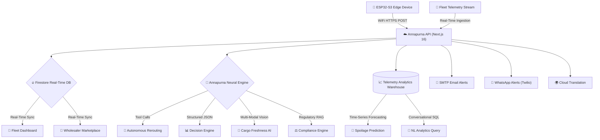

---

## 🛡️ Security & Guardrails

- **Strict Database Security Rules:** Client-side mutations are denied (`allow write: if false;`). All database writes are authenticated through backend Next.js API endpoints utilizing privileged Admin SDK instances.
- **SQL Injection Prevention:** Conversational analytics queries are restricted to parameterized `SELECT` queries with dataset isolation and a mandatory 100-row return ceiling.
- **Credential Hygiene:** Separation of public client identifiers and server-side secret tokens. All secrets load via environment variables (`.env.local` / Secret Manager).
- **Graceful Deterministic Fallback:** Critical rerouting and evaluation logic includes deterministic rule-based fallbacks should external AI APIs experience latency or downtime.

---

## 🏃 Getting Started

### Prerequisites
- **Node.js:** v20.x or later
- **npm:** v10.x or later
- *(Optional)* Google Cloud Platform project with Vertex AI and Firestore enabled
- *(Optional)* Firebase project for authentication

### 1. Clone the Repository
```bash
git clone https://github.com/Kenkei69/Annapurna.git
cd Annapurna
```

### 2. Install Dependencies
```bash
npm install
```

### 3. Configure Environment Variables
Copy the template and configure your credentials:
```bash
cp .env.example .env.local
```

Key environment variables to define in `.env.local`:
| Variable | Description | Default / Example |
|---|---|---|
| `NEXT_PUBLIC_APP_URL` | Base application URL | `http://localhost:3000` |
| `GEMINI_API_KEY` | Google Gemini API key | — |
| `GCP_PROJECT_ID` | GCP Project ID | `your-gcp-project-id` |
| `GOOGLE_APPLICATION_CREDENTIALS` | Path to service account JSON | — |
| `NEXT_PUBLIC_FIREBASE_API_KEY` | Firebase Web API Key | — |
| `NEXT_PUBLIC_FIREBASE_PROJECT_ID` | Firebase Project ID | — |
| `SMTP_EMAIL` | Sender email address for SMTP | — |
| `SMTP_PASSWORD` | App password for SMTP email | — |
| `TWILIO_ACCOUNT_SID` | Twilio Account SID for WhatsApp | — |
| `TWILIO_AUTH_TOKEN` | Twilio Auth Token for WhatsApp | — |

*Refer to [.env.example](.env.example) for the complete list.*

### 4. Run the Development Server
```bash
npm run dev
```
Open [http://localhost:3000](http://localhost:3000) in your browser to view the application.

### 5. Build for Production
```bash
npm run build
npm start
```

### 6. IoT Firmware Setup
To flash the ESP32-S3 edge device:
1. Open `firmware/esp32_s3_telemetry/esp32_s3_telemetry.ino` in the Arduino IDE or PlatformIO.
2. Update `WIFI_SSID`, `WIFI_PASSWORD`, and `API_URL` with your network details and deployed backend URL.
3. Flash to an ESP32-S3 board with required sensor wiring.

---

## 📸 Screenshots

<div align="center">
  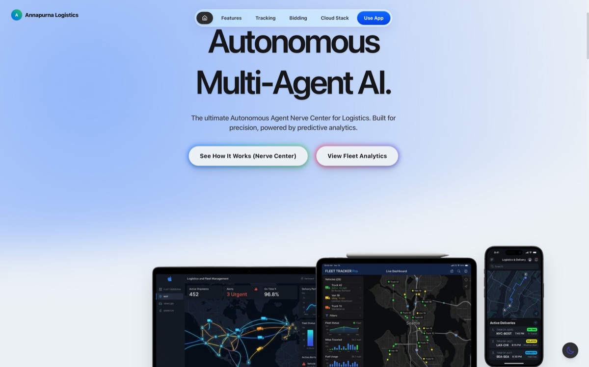
  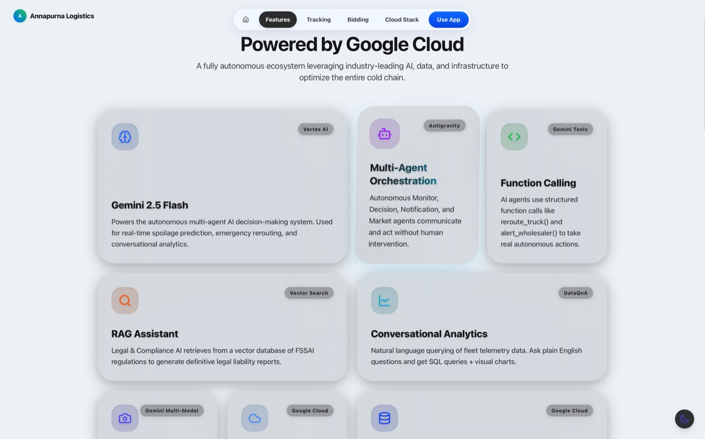
  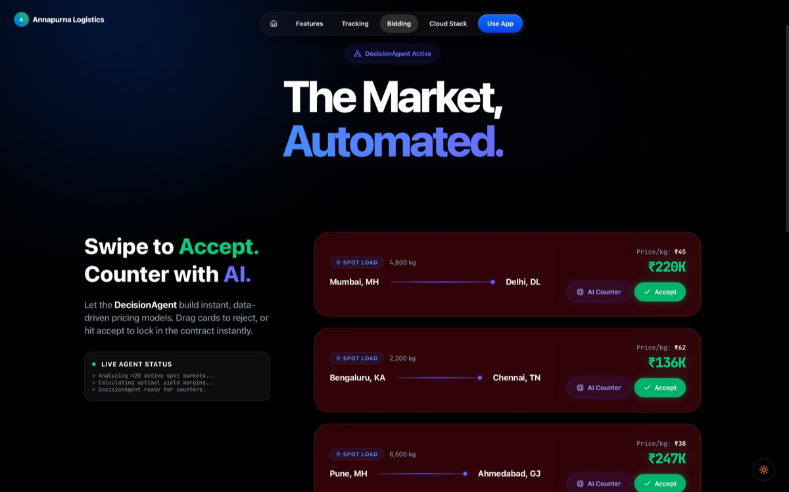
  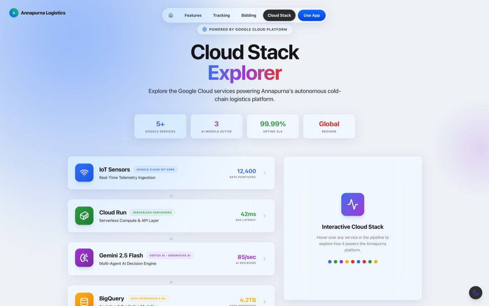
  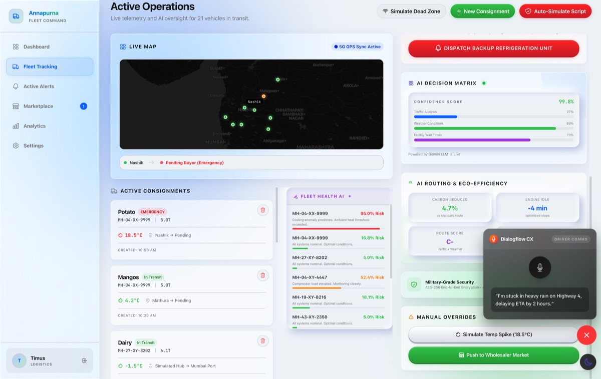
  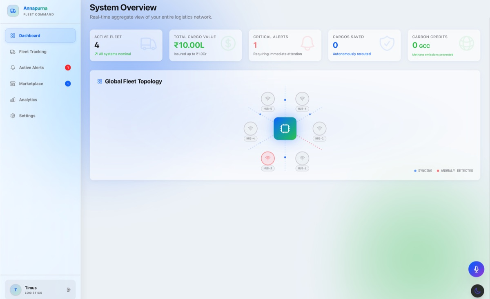
  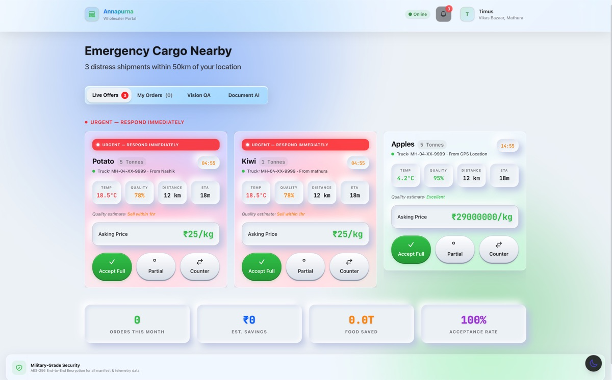
  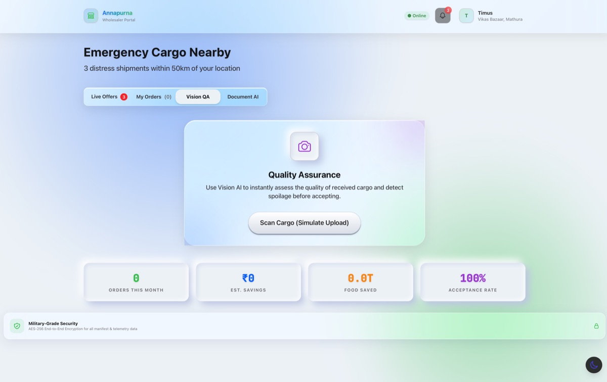
  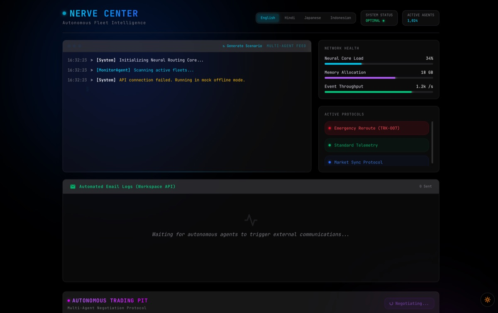
  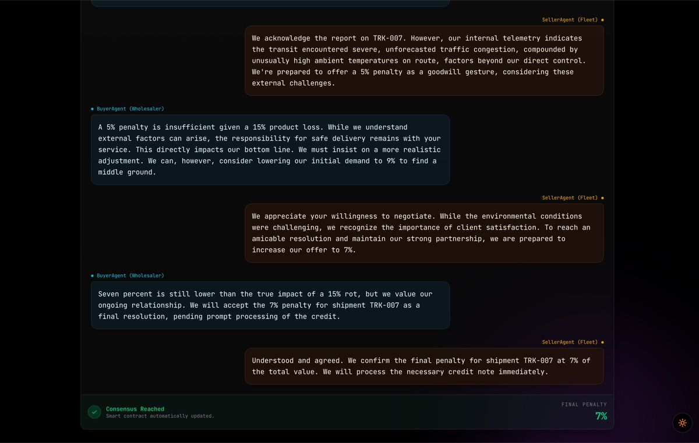
  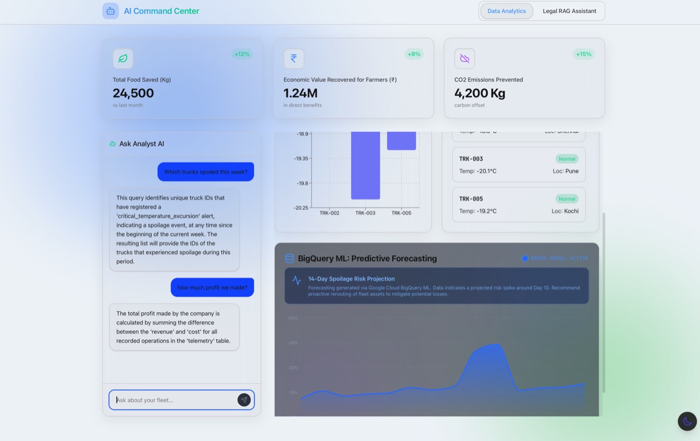
  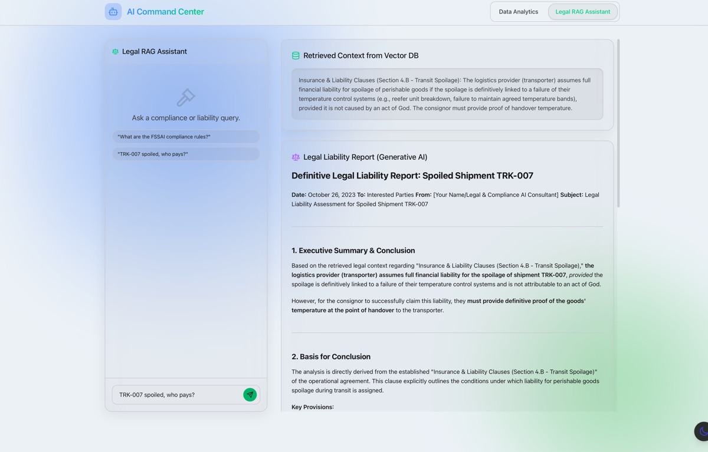
</div>

---

## 📜 Attribution & Origin

This repository is an independently maintained version of **Annapurna**, maintained by **[Kenkei69](https://github.com/Kenkei69)**.

- **Original Project:** [Annapurna-Gemini-APAC](https://github.com/sumitsaraswat362/Annapurna-Gemini-APAC)
- **Original Author:** [Sumit Saraswat](https://github.com/sumitsaraswat362)
- **Original Context:** Developed as an innovation prototype for the Google GenAI APAC Academy.

All foundational system designs, hardware prototypes, process flow diagrams, and architectural concepts originating from the initial prototype are gratefully acknowledged. For formal notices, please refer to the [NOTICE](NOTICE) file.

---

## 📄 License & Maintenance

Independently maintained by **Kenkei69**. Contributions, bug reports, and suggestions are welcome via [GitHub Issues](https://github.com/Kenkei69/Annapurna/issues) and Pull Requests.
